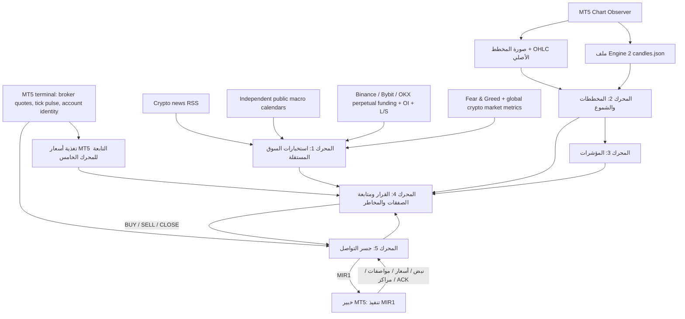

# التصميم المعتمد لمحركات مرصاد البيتكوين

## المعمارية الخماسية وفصل ملكية البيانات

مرصاد منصة تحليل وقرار متكاملة، وليس خبير تداول مستقلاً. المحرك الرابع هو مركز اتخاذ القرار ومتابعة الصفقات وإدارة المخاطر، ويجمع مخرجات المحركات الثلاثة الأولى. المحرك الخامس هو جسر التواصل الثنائي مع خبير MT5.

## حدود المسؤولية الصارمة

| المحرك | ما يملكه | ما لا يفعله |
|---|---|---|
| **1 — استخبارات السوق** | مصادر مستقلة: أخبار متعددة الناشرين؛ تقاويم اقتصادية عامة (ShowMyTrades وTrading Economics الاختياري)؛ Fear & Greed؛ مقاييس السوق الكلي؛ مشتقات Binance/Bybit/OKX (Funding وOpen Interest وLong/Short)؛ درجة أدلة وسياق قابلة للتدقيق | لا يستقبل أي مدخل من المحركات 2 أو3 أو5، ولا يقرأ أسعار MT5 أو الصور أو OHLC أو الشموع أو المؤشرات؛ يرسل تقريره المستقل إلى المحرك الرابع فقط بوزن أساسي 20% |
| **2 — المخططات والشموع** | صور المخططات الحقيقية، تحقق الصورة، معايرة محور السعر، استخراج الشموع وOHLC، سجل MT5 الأصلي متعدد الأطر، بنية السعر والقمم والقيعان والدعم والمقاومة والأنماط المرئية | لا يصدر أمراً تنفيذياً مستقلاً، ولا يملك إدارة المخاطر |
| **3 — المؤشرات** | حساب EMA وRSI وATR والاتجاهات متعددة الأطر حصراً من الشموع المكتملة التي يجهزها المحرك الثاني | لا يقرأ ملف المحرك الأول بحثاً عن الشموع، ولا يجلب شموعاً مستقلة، ولا يصدر تصويتاً منفصلاً خارج مركز القرار |
| **4 — القرار ومتابعة الصفقات** | يدمج تقرير المحرك 1 (20%) وتحليل المحرك 2 (50%) ومؤشرات المحرك 3 (30%)؛ ويتحقق بصورة مستقلة من سلامة سعر MT5 وهوية الحساب والسبريد قبل القرار، ويمتلك BUY/SELL/WAIT/HOLD/CLOSE وإدارة المراكز والمخاطر | لا ينقل الأوامر مباشرة إلى MT5 ولا يسمح لبيانات المحرك الخامس بالتصويت الاتجاهي |
| **5 — جسر التواصل** | حالة اتصال MT5، نبض الخبير، سعر التنفيذ ومصدر الاقتباس والسبريد ومواصفات الرمز والحساب والمراكز وإقرارات التنفيذ، ونقل أوامر MIR1 | لا يقرر اتجاه السوق ولا يحسب المخاطر ولا يدخل ضمن أوزان التصويت الثلاثية |
| **خبير MT5** | ينفذ أمر MIR1 المصرح به ويعيد حالة التنفيذ | لا ينشئ إشارة تداول مستقلة |

## الفصل الفعلي للملفات

- `MirsadBTC/market.json` — لقطة MT5 الخام التي يقرأها محول الأسعار التابع للمحرك الخامس `MIR-MT5-MARKET-2`: الهوية وBid/Ask والنبض والسبريد وعمق السوق إن وفره الوسيط؛ لا تحتوي OHLC، ولا تدخل في استخبارات المحرك الأول.
- `data/latest_market.json` — لقطة تغذية أسعار MT5 التابعة للمحرك الخامس فقط؛ لا تدمج تقرير المحرك الأول فيها.
- `data/mirsad.sqlite3 / market_intelligence_snapshots` — سجل مستقل لتقارير المحرك الأول ومصادرها وتوقيتاتها، مع الاحتفاظ بآخر 30 يوماً.
- `MirsadBTC/observer/candles.json` — عقد الشموع الخاص بالمحرك الثاني `MIR-ENGINE2-CANDLES-1`: ستة أطر زمنية من CopyRates، مع عدد السجلات ورمز الخطأ وحالة الشمعة المغلقة/قيد التكوين.
- `MirsadBTC/observer/capture_*.json` والصورة المرتبطة بها — حزمة التقاط المخطط التي يتحقق منها المحرك الثاني بصرياً وزمنياً.
- `MirsadBTC/status.json` — حالة جسر المحرك الخامس؛ تُستخدم مطابقة الرمز والخادم وعرض السعر، ولا تصبح مصدراً للشموع.

لا يقرأ المحرك الأول ملف `candles.json` إطلاقاً. قارئ الشموع `MT5ChartCandleHistory` يتبع المحرك الثاني. ومحرك المؤشرات `IndicatorsEngine` لا يقبل سوى نتيجة Candle History بحالة READY من المحرك الثاني. إذا غاب الملف أو فشل التحقق، تبقى المؤشرات والقرار في WAIT/NOT_READY.

## محرك السوق والأحداث الاقتصادية

مصدر أسعار الوسيط الحي هو طرفية MT5 التي اختارها المستخدم، وتملكه تغذية المحرك الخامس عبر `MT5MarketDataEngine`. تقرأ `CopyTicksRange` باستخدام `COPY_TICKS_INFO` وتسمى النتيجة **اتجاه تحديثات الأسعار** أو **توازن عروض الأسعار**؛ لا تسمى شراء/بيع Taker أو تدفق صفقات منفذة. وتحسب هذه التغذية السبريد الحالي ومتوسطه وأقصاه ومعدل التحديث والتغير النسبي لمنتصف Bid/Ask. هذه بيانات تحقق سلامة وسعر للمحرك الرابع، وليست جزءاً من تصويت استخبارات المحرك الأول.

تعمل طبقة `MarketIntelligenceEngine` مستقلة تماماً عن MT5 وعن المحركات الأخرى، وتقرأ ملخصات RSS من CoinDesk وCointelegraph وThe Block وDecrypt، وتقويمات اقتصادية عامة مستقلة، ومؤشر Fear & Greed وبيانات السوق الكلي من Alternative.me، ومعدلات التمويل والفائدة المفتوحة ونسب Long/Short من Binance وBybit وOKX perpetual. أضيف موصل OKX العام كمسار بديل؛ نسبة Long/Short في OKX هنا مجمعة على عقود العملة الأساسية، ويُسجل نطاقها صراحةً بدلاً من نسبتها إلى عقد منفرد. تُزال العناوين المتطابقة بين الناشرين من عدّ القصص مع الاحتفاظ بقائمة مصادرها حتى لا يتضخم وزن خبر واحد. تُفحص حداثة Fear & Greed (36 ساعة افتراضياً)، وبيانات السوق الكلي (24 ساعة)، والمشتقات (15 دقيقة) قبل عرض حالتها على أنها حديثة أو السماح لها بالمساهمة. تُحفظ العناوين مع الناشر والرابط ووقت النشر، ولا تُنسخ مقالات كاملة. تحليل المشاعر شفاف وقائم على قاموس كلمات معلن؛ لا يدّعي التحقق من الخبر أو فهمه دلالياً.

يعد تقويم ShowMyTrades العام المصدر الأساسي المستقل المتاح بلا مفتاح، وتُدمج معه أحداث Trading Economics إذا أُعدّ المتغير `MIRSAD_TRADING_ECONOMICS_API_KEY` على بيئة التشغيل. التقويم الخارجي متعدد الدول افتراضياً: الولايات المتحدة والصين ومنطقة اليورو والمملكة المتحدة واليابان وكندا وأستراليا وكوريا الجنوبية، ويمكن ضبط القائمة عبر `MIRSAD_TRADING_ECONOMICS_CALENDAR_COUNTRIES`. يحتفظ الحدث بالتوقع والسابق والفعلي والناشر ورابط المصدر عند توفرها. لا يُخترع أي حدث عند غياب المصدر. فترة الحجب الافتراضية للأحداث عالية الأهمية هي 15 دقيقة قبل الحدث و10 دقائق بعده؛ يوقف المحرك الرابع المداخل الجديدة فقط، ولا يوقف CLOSE أو التعديل الوقائي. يضيف المحرك الأول تصنيفاً وصفياً لمخاطر السياق وعوامل الازدحام/الأحداث/الأخبار؛ لا ينشئ هذا التصنيف حاجز دخول مستقلاً ولا يحل محل قرار ومخاطر المحرك الرابع.

## المحرك الثاني والثالث

تبدأ سلسلة صورة MT5 داخل المحرك الثاني من المكوّن `mirsad.engines.mt5_chart_pipeline.Engine2MT5ChartImagePipeline`: يقرأ أحدث `capture_<id>.json` من `Common\\Files\\MirsadBTC\\observer` ويطابقه مع PNG داخل `observer\\images`، ثم يتحقق من سلامة الصورة والحداثة والهوية والرمز والإطار ومزامنة الصورة مع OHLC. لا يقبل هذا المسار تقرير المحرك الأول؛ ويستخدم جسر المحرك الخامس للتحقق من رمز الوسيط ورمز السوق وخادم الحساب فقط. بعد ذلك يسلّم الصورة إلى `mirsad.engines.chart.analyze_chart_image` لتشغيل مراحل `chart_image.py` و`chart_calibration.py` و`chart_extraction.py` و`chart_patterns.py` و`chart_metrics.py` وغيرها. لذلك لا ينشئ المحرك ملتقطاً آخر؛ بل يستهلك مباشرةً ملفات خبير MT5 الموجود. واجهة تحميل تاريخ الشموع الأصلي هي `mirsad.engines.mt5_chart_candles.MT5ChartCandleHistory`; وتتحقق من حداثة الملف وهوية الرمز والخادم من ملف الشموع وجسر المحرك الخامس فقط، وصحة OHLC وترتيب الزمن ووجود شمعة تشكيل أخيرة؛ ولا تقرأ مخرجات المحرك الأول، وحد أدنى قدره 50 شمعة مغلقة في 1m و5m و15m.

واجهة المؤشرات هي `mirsad.engines.indicators.IndicatorsEngine.analyze` وتستقبل نتيجة المحرك الثاني فقط. تستبعد الشمعة قيد التكوين، وتحسب 20 مقياساً فنياً على ستة أطر زمنية، منها EMA20/EMA50 وRSI14 وATR14 وMACD/OSMA وBollinger وStochastic وADX/+DI/-DI وCCI وMFI وMomentum وWilliams %R وOBV. تقارن واجهة `MT5NativeIndicatorHistory` القيم الأصلية من CopyBuffer، وتفرض تطابق وقت الشمعة المغلقة والجارية مع سجل OHLC للمحرك الثاني في كل إطار؛ كما توجد بوابة منفصلة للمطابقة الرقمية عبر 20 مؤشراً × 6 أطر.

لا يتحول كل مؤشر إلى صوت مستقل. يبني المحرك الثالث تصويتاً مركباً من خمس عائلات متمايزة: الاتجاه 25%، الزخم 30%، قوة الاتجاه عبر ADX/DI 15%، المتذبذبات 15%، وتدفق الحجم 15% (مبني على tick_volume الخاص بوسيط MT5 كوكيل نشاط، وليس حجماً موحداً للصفقات المنفذة). داخل كل عائلة تُجمع الإشارات المترابطة في درجة واحدة، ويضرب وزن العائلة في نسبة ميزاتها الصالحة؛ ثم يعاد تطبيع الأوزان المتاحة. تعاد تجميعة الأطر بحسب أوزانها الزمنية وجودة إشارة كل إطار. يشترط حد جودة 60% على الأطر الأساسية M1/M5/M15؛ وإلا لا يعلن المحرك READY ولا يقبل المحرك الرابع التصويت الفني. ATR لا يصوت على الاتجاه، بل يستخدم لقياس التقلب وتطبيع MACD/OSMA وإدارة المخاطر. لا يعاد توجيه بيانات شموع المحرك الأول إلى هذه الواجهة.

## مبدأ دمج الأدلة في القرار

يعتمد المحرك الرابع أوزاناً أساسية مجموعها 100%: **المحرك الأول 20%، المحرك الثاني 50%، المحرك الثالث 30%**. المحرك الثاني يجمع داخلياً **70% لبنية السعر من OHLC الأصلي متعدد الأطر و30% للتحليل البصري** بشرط أن تكون الصورة معايرة ومؤهلة؛ إذا فشلت الصورة أو لم تتوفر، يستعمل المحرك الثاني بنية OHLC وحدها ولا يختلق درجة بصرية ولا يجعل الصورة غير المعايرة شرطاً لتعطيل تحليل OHLC الجاهز.

داخل المحرك الأول تتوزع استخبارات الاتجاه على المشتقات 45%، الأخبار 35%، والخوف والطمع 20%. لا تدخل الأخبار المتكررة كقصص منفصلة، ولا يدخل عامل المشتقات إذا لم يثبت حداثته، ولا يدخل Fear & Greed إذا تجاوز 36 ساعة. المقاييس الكلية والتقويم الاقتصادي تقدم سياقاً ومخاطر ولا تضيف تصويتاً اتجاهياً مستقلاً حالياً.

الأوزان النهائية لا تُطبّق بصورة عمياء: يحسب المحرك الرابع لكل مصدر جودة دليل من الجاهزية والتغطية والتوافق، ثم يضرب الوزن الأساسي في جودة المصدر ويعيد تطبيع الأوزان الفعالة إلى 100%. لذلك إذا غابت استخبارات المحرك الأول مثلاً، يعاد توزيع وزنه على المحركين الثاني والثالث بحسب أوزانهما وجودة أدلتهما. تغذية اقتباس MT5 التابعة للمحرك الخامس شرط مستقل لسلامة السعر والتنفيذ وليست تصويتاً رابعاً أو جزءاً من درجة المحرك الأول. درجة الأخبار والمشتقات والمشاعر ليست احتمال ربح معايراً. الحد الأدنى لاتجاه المحرك الثاني هو 0.20، ويشترط توافق بنية متعددة الأطر بتغطية وأغلبية كافيتين، وحد القرار المركب 0.40. هذه قيم تشغيل أولية محافظة وتحتاج اختباراً تاريخياً زمنياً خارج العينة قبل اعتبارها معايرة إحصائية أو دليلاً على الربحية.

## ضوابط القرار والتنفيذ

- يجب أن تكون تغذية أسعار MT5 التابعة للمحرك الخامس حديثة، والاقتباسات سليمة وغير متقاطعة، وهوية الرمز والخادم متطابقة بين قارئ سعر المحرك الخامس وجسر التنفيذ ولقطة Observer التي يستهلكها المحرك الثاني.
- تدخل الصورة في الجزء البصري من وزن المحرك الثاني فقط بعد اجتياز بوابات الهوية والمعايرة والتطابق الزمني/السعري. إذا فشلت الصورة، يستبعد دليلها البصري بالكامل ويستمر المحرك الثاني باستخدام بنية OHLC الأصلية فقط متى كانت READY ومتوافقة عبر الأطر؛ لا تُخفض أهلية OHLC بسبب خلل الصورة. ويشترط المحرك الرابع سلامة تغذية الأسعار التابعة للمحرك الخامس وجاهزية المحرك الثالث قبل تقييم اتجاه جديد.
- لا تدخل المؤشرات في القرار إذا كان سجل شموع المحرك الثاني مفقوداً أو قديماً أو غير سليم.
- يحاذي المحرك الرابع الدخول والوقف والهدف مع Tick Size ومستوى الوقف الأدنى لدى الوسيط ثم يحسب الحجم.
- عند انعكاس إشارة مؤكدة أمام مركز مرصاد قائم، يطلب المحرك الرابع إغلاق تذكرة مرصاد المعاكسة أولاً وينتظر تحديث MT5 قبل فتح الاتجاه المقابل.
- يحمل كل مركز Magic Number خاصاً بمرصاد. لا يغلق الخبير صفقة يدوية أو صفقة خبير آخر.
- يحمل كل أمر MIR1 معرفاً ثابتاً لمنع التكرار، ولا يستبدل الجسر أمراً غير محسوم.
- لا ينشر الجسر أمراً إلا إذا أجازه المحرك الرابع وكان متصلاً وتأكدت حداثة الاقتباس.

## اختبار وبناء وحدات MT5

بناء Observer في GitHub Actions يثبت قابلية تجميع ملف MQL5 فقط. لا يثبت وجود طرفية MT5 حية أو توفر تقويم الوسيط أو وصول الملف إلى Common Files على جهاز المستخدم. اختبارات Python تتحقق من عقود الملفات والحواجز دون إنشاء أوامر تداول. اختبارات CI لا تثبت الربحية أو تشغيل 24/7 أو نجاح صفقة حقيقية.

## حدود النسخة

- قد لا يقدم وسيط MT5 تاريخاً اقتصادياً متاحاً؛ حينها يبقى التقويم NOT_AVAILABLE.
- سلسلة CopyTicks INFO هي تحديثات عروض Bid/Ask وليست سجل صفقات منفذة أو دفتر أوامر.
- مصادر الأخبار وFear & Greed والمشتقات قد تتأخر أو تتوقف أو تختلف بين المنصات؛ حالة PARTIAL لا تُعرض كأنها READY.
- لا تعني الدرجة السياقية أو مؤشر الثقة احتمالاً إحصائياً أو ضماناً للربح، ويظل تقييم صلاحية هذه الأوزان خارج الاختبار الوحدوي.
- نجاح التقاط صورة MT5 لا يعني أن المحرك الثاني عايرها أو أن القرار أصبح جاهزاً.
- لا تعتبر حالة READY في اختبار الوحدة إثباتاً لتغذية حية على جهاز المستخدم؛ يجب التحقق من بيانات Common Files الحقيقية قبل أي استخدام تشغيلي.
