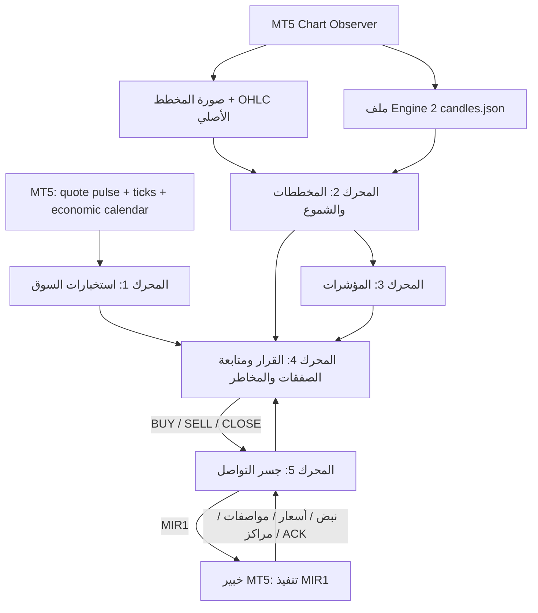

# التصميم المعتمد لمحركات مرصاد البيتكوين

## المعمارية الخماسية وفصل ملكية البيانات

مرصاد منصة تحليل وقرار متكاملة، وليس خبير تداول مستقلاً. المحرك الرابع هو مركز اتخاذ القرار ومتابعة الصفقات وإدارة المخاطر، ويجمع مخرجات المحركات الثلاثة الأولى. المحرك الخامس هو جسر التواصل الثنائي مع خبير MT5.

## حدود المسؤولية الصارمة

| المحرك | ما يملكه | ما لا يفعله |
|---|---|---|
| **1 — استخبارات السوق** | السعر اللحظي Bid/Ask، حركة تحديثات الأسعار، عدد التحديثات وسرعتها، اتزان التحديثات الصاعدة/الهابطة، السبريد وتغيره، حالة السيولة التي يمكن استنتاجها من بيانات متاحة فعلاً، وتقويم الأحداث الاقتصادية الذي يقدمه وسيط MT5 | لا يقرأ صور المخططات، ولا يستخرج أو يخزن أو يحلل OHLC أو الشموع، ولا يحسب EMA/RSI/ATR، ولا يدّعي أن تحديث Bid/Ask صفقة منفذة أو دفتر أوامر |
| **2 — المخططات والشموع** | صور المخططات الحقيقية، تحقق الصورة، معايرة محور السعر، استخراج الشموع وOHLC، سجل MT5 الأصلي متعدد الأطر، بنية السعر والقمم والقيعان والدعم والمقاومة والأنماط المرئية | لا يصدر أمراً تنفيذياً مستقلاً، ولا يملك إدارة المخاطر |
| **3 — المؤشرات** | حساب EMA وRSI وATR والاتجاهات متعددة الأطر حصراً من الشموع المكتملة التي يجهزها المحرك الثاني | لا يقرأ ملف المحرك الأول بحثاً عن الشموع، ولا يجلب شموعاً مستقلة، ولا يصدر تصويتاً منفصلاً خارج مركز القرار |
| **4 — القرار ومتابعة الصفقات** | يدمج حالة السوق من 1، والتحليل البصري والشموع من 2، والمؤشرات من 3؛ ويمتلك BUY/SELL/WAIT/HOLD/CLOSE وإدارة المراكز والوقف والهدف والحجم والمخاطر | لا ينقل الأوامر مباشرة إلى MT5 |
| **5 — جسر التواصل** | حالة اتصال MT5، نبض الخبير، سعر التنفيذ، مواصفات الرمز والحساب والمراكز وإقرارات التنفيذ، ونقل أوامر MIR1 | لا يقرر اتجاه السوق ولا يحسب المخاطر |
| **خبير MT5** | ينفذ أمر MIR1 المصرح به ويعيد حالة التنفيذ | لا ينشئ إشارة تداول مستقلة |

## الفصل الفعلي للملفات

- `MirsadBTC/market.json` — عقد المحرك الأول `MIR-MT5-MARKET-2`: هوية الطرفية والرمز، Bid/Ask، عمر آخر Tick، سلسلة تحديثات الأسعار، وتقويم MT5 الاقتصادي. لا يحتوي مصفوفات OHLC أو مفاتيح أطر زمنية.
- `MirsadBTC/observer/candles.json` — عقد الشموع الخاص بالمحرك الثاني `MIR-ENGINE2-CANDLES-1`: ستة أطر زمنية من CopyRates، مع عدد السجلات ورمز الخطأ وحالة الشمعة المغلقة/قيد التكوين.
- `MirsadBTC/observer/capture_*.json` والصورة المرتبطة بها — حزمة التقاط المخطط التي يتحقق منها المحرك الثاني بصرياً وزمنياً.
- `MirsadBTC/status.json` — حالة جسر المحرك الخامس؛ تُستخدم مطابقة الرمز والخادم وعرض السعر، ولا تصبح مصدراً للشموع.

لا يقرأ المحرك الأول ملف `candles.json` إطلاقاً. قارئ الشموع `MT5ChartCandleHistory` يتبع المحرك الثاني. ومحرك المؤشرات `IndicatorsEngine` لا يقبل سوى نتيجة Candle History بحالة READY من المحرك الثاني. إذا غاب الملف أو فشل التحقق، تبقى المؤشرات والقرار في WAIT/NOT_READY.

## محرك السوق والأحداث الاقتصادية

مصدر التشغيل الحي الحالي هو طرفية MT5 التي اختارها المستخدم فقط. يقرأ المحرك الأول سلسلة تحديثات Bid/Ask من `CopyTicksRange` باستخدام `COPY_TICKS_INFO`. لذلك تسمى النتيجة **اتجاه تحديثات الأسعار** أو **توازن عروض الأسعار**، ولا تسمى شراء/بيع Taker أو تدفق صفقات منفذة. كما يحسب السبريد الحالي ومتوسطه وأقصاه ومعدل تحديث السعر والتغير النسبي لمنتصف Bid/Ask.

يستعلم Observer عن تقويم MT5 الاقتصادي لعملة USD ويحول الأوقات إلى UTC، مع أهمية الحدث. هذا تقويم أحداث اقتصادية كلية يوفره وسيط MT5، وليس موجز عناوين أخبار العملات الرقمية أو الأخبار الجيوسياسية. إذا لم يوفر الوسيط التقويم أو أخفق الاستعلام، تعرض الحالة NOT_AVAILABLE ولا ينشئ البرنامج أحداثاً بديلة. أي توسعة إلى أخبار BTC النصية تحتاج مزود أخبار موثوقاً مستقلاً مع المصدر ووقت النشر وعمر الخبر وتقييم الصلة؛ لم يُدمج هذا الموجز النصي بعد.

## المحرك الثاني والثالث

واجهة التحليل البصري هي `mirsad.engines.chart.analyze_chart_image`. وهي مسؤولة عن الصورة ومعايرة المحور واستخراج OHLC والأنماط والبنية والاتجاه البصري وجودة الأدلة. واجهة تحميل تاريخ الشموع الأصلي هي `mirsad.engines.mt5_chart_candles.MT5ChartCandleHistory`; وتتحقق من حداثة الملف، وهوية الرمز والخادم مع المحركين 1 و5، وصحة OHLC وترتيب الزمن ووجود شمعة تشكيل أخيرة، وحد أدنى قدره 50 شمعة مغلقة في 1m و5m و15m.

واجهة المؤشرات هي `mirsad.engines.indicators.IndicatorsEngine.analyze` وتستقبل نتيجة المحرك الثاني فقط. تستبعد الشمعة قيد التكوين، وتحسب EMA20/EMA50 وRSI14 وATR14 وملخص اتجاه الأطر. لا يعاد توجيه بيانات شموع المحرك الأول إلى هذه الواجهة.

## مبدأ دمج الأدلة في القرار

تبقى مساهمة التحليل البصري المؤهل للمحرك الثاني 80% من الدرجة الاتجاهية. أما نسبة التأكيد المتبقية 20% فتتكون داخلياً من 16% للمؤشرات المحسوبة من شموع المحرك الثاني و4% لنبض تحديثات الأسعار من المحرك الأول. عند عدم توفر نبض صالح لا يُختلق مكوّن بديل؛ ويستخدم مكوّن المؤشرات وحده للتأكيد الثانوي. لا يستطيع المحرك الأول إنشاء قرار اتجاهي بمفرده، ولا يعوض فشل معايرة صورة المحرك الثاني.

## ضوابط القرار والتنفيذ

- يجب أن تكون لقطة MT5 حديثة، والاقتباسات سليمة وغير متقاطعة، وهوية الرمز وخادم الحساب متطابقة بين المحركات 1 و2 و5.
- لا تدخل صورة المخطط في القرار قبل اجتياز بوابات الصورة والمعايرة والتطابق الزمني/السعري.
- لا تدخل المؤشرات في القرار إذا كان سجل شموع المحرك الثاني مفقوداً أو قديماً أو غير سليم.
- يحاذي المحرك الرابع الدخول والوقف والهدف مع Tick Size ومستوى الوقف الأدنى لدى الوسيط ثم يحسب الحجم.
- عند انعكاس إشارة مؤكدة أمام مركز مرصاد قائم، يطلب المحرك الرابع إغلاق تذكرة مرصاد المعاكسة أولاً وينتظر تحديث MT5 قبل فتح الاتجاه المقابل.
- يحمل كل مركز Magic Number خاصاً بمرصاد. لا يغلق الخبير صفقة يدوية أو صفقة خبير آخر.
- يحمل كل أمر MIR1 معرفاً ثابتاً لمنع التكرار، ولا يستبدل الجسر أمراً غير محسوم.
- لا ينشر الجسر أمراً إلا إذا أجازه المحرك الرابع وكان متصلاً وتأكدت حداثة الاقتباس.

## اختبار وبناء وحدات MT5

بناء Observer في GitHub Actions يثبت قابلية تجميع ملف MQL5 فقط. لا يثبت وجود طرفية MT5 حية أو توفر تقويم الوسيط أو وصول الملف إلى Common Files على جهاز المستخدم. اختبارات Python تتحقق من عقود الملفات والحواجز دون إنشاء أوامر تداول. اختبارات CI لا تثبت الربحية أو تشغيل 24/7 أو نجاح صفقة حقيقية.

## حدود النسخة

- قد لا يقدم وسيط MT5 تاريخاً اقتصادياً متاحاً؛ حينها يبقى التقويم NOT_AVAILABLE.
- سلسلة CopyTicks INFO هي تحديثات عروض Bid/Ask وليست سجل صفقات منفذة أو دفتر أوامر.
- نجاح التقاط صورة MT5 لا يعني أن المحرك الثاني عايرها أو أن القرار أصبح جاهزاً.
- لا تعتبر حالة READY في اختبار الوحدة إثباتاً لتغذية حية على جهاز المستخدم؛ يجب التحقق من بيانات Common Files الحقيقية قبل أي استخدام تشغيلي.
