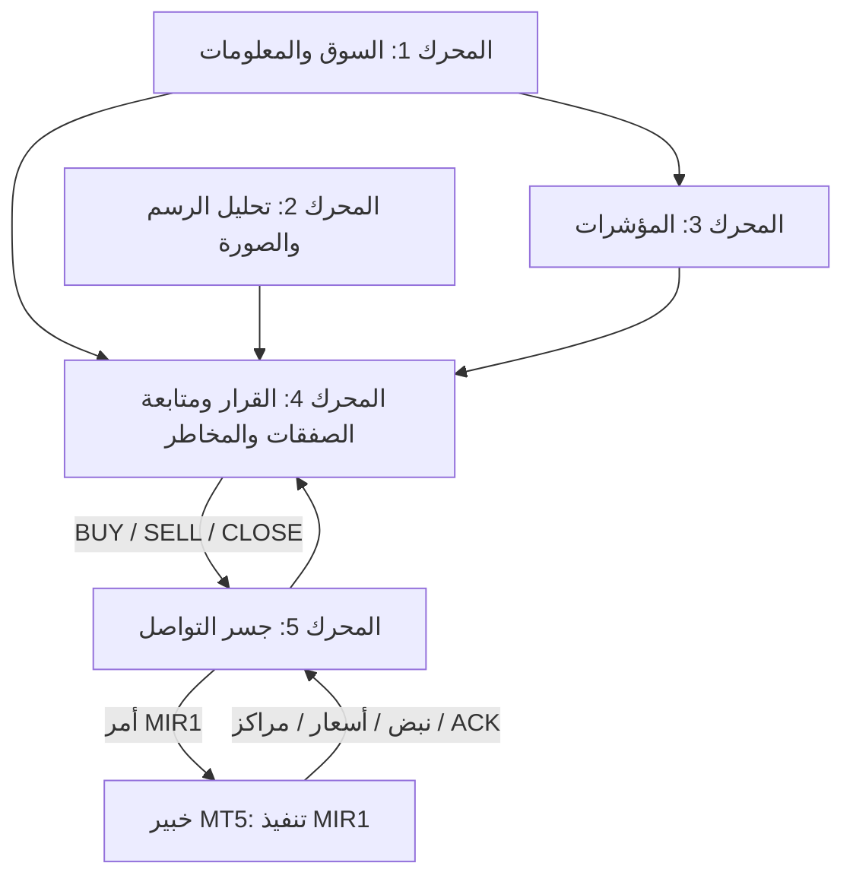

# التصميم المعتمد لمحركات مرصاد البيتكوين

## المعمارية الخماسية

المحرك الرابع هو مركز اتخاذ القرار ومتابعة الصفقات وإدارة المخاطر. يستقبل:
- أدلة السوق من المحرك الأول.
- التحليل البصري المؤهل من المحرك الثاني.
- قياسات المؤشرات المحسوبة من المحرك الثالث.

المحرك الخامس هو جسر التواصل ثنائي الاتجاه مع خبير MT5. لا يقرر اتجاه السوق ولا يحسب المخاطر؛ ينقل أوامر MIR1 التي أجازها المحرك الرابع ويعيد حالة التنفيذ والنبض والاقتباس والمراكز.

## حدود المسؤولية

| المحرك | المسؤولية | الحدود |
|---|---|---|
| 1 — السوق والمعلومات | جمع الأسعار والشموع والدفاتر والصفقات العامة وتخزينها | لا يرسل أوامر إلى منصات البيانات |
| 2 — التحليل البصري | تحليل المخططات الحقيقية واستخراج OHLC والبنية والأنماط بعد اجتياز بوابات الجودة | لا يصدر قرار تداول منفرداً |
| 3 — المؤشرات | حساب EMA وRSI وATR واتجاه الأطر من OHLC المكتمل للمحرك الأول | لا يجلب مصدراً مستقلاً ولا يضيف تصويتاً اتجاهياً منفصلاً |
| 4 — القرار ومتابعة الصفقات | دمج السوق والتحليل والمؤشرات، وإصدار BUY/SELL/WAIT/HOLD/CLOSE، وإدارة المراكز والمخاطر | لا ينقل الأوامر مباشرة إلى MT5 |
| 5 — جسر التواصل | قراءة حالة MT5 والاقتباس والحساب ومواصفات الرمز والمراكز وACK، ونقل أوامر MIR1 | لا ينشئ إشارة ولا يحسب المخاطرة |
| خبير MT5 | تنفيذ أمر MIR1 كما ورد وإعادة حالة التنفيذ | لا ينشئ إشارة من OnTick ولا يقرر الدخول |

## ضوابط القرار والتنفيذ

- لا يصدر المحرك الرابع إشارة اتجاهية إلا مع وجود مصدرين عامين مباشرين مستقلين على الأقل بحالة LIVE.
- التحليل البصري لا يدخل القرار قبل اجتياز بوابات جودة الصورة والمعايرة والتطابق الزمني/السعري.
- المؤشرات تحسب من الشموع المكتملة؛ ولا تضيف تصويتاً منفصلاً فوق مزيج الأدلة المعتمد.
- يجب أن يكون سعر MT5 حديثاً، وأن يتطابق رمز السوق، وأن يكون فرق السعر عن مرجع السوق والسبريد ضمن الحدود المسموح بها.
- يحاذي المحرك الرابع الدخول والوقف والهدف مع Tick Size ومستوى الوقف الأدنى لدى الوسيط ثم يحسب الحجم.
- عند انعكاس إشارة مؤكدة أمام مركز مرصاد قائم، يطلب المحرك الرابع إغلاق تذكرة مرصاد المعاكسة أولاً وينتظر تحديث MT5 قبل فتح الاتجاه المقابل.
- يحمل كل مركز Magic Number خاصاً بمرصاد. لا يغلق الخبير صفقة يدوية أو صفقة خبير آخر.
- يحمل كل أمر MIR1 معرفاً ثابتاً لمنع التكرار، ولا يستبدل الجسر أمراً غير محسوم.
- لا يرسل المحرك الخامس أي أمر إلا عندما يكون المحرك الرابع قد أجازه والجسر متصلاً والاقتباس حديثاً ومتطابقاً.

## تشغيل GitHub Actions

يثبت اختبار Windows إمكانية تجميع Observer و/أو الخبير التنفيذي والتحقق من الاتصال وفق سير العمل المحدد. اختبار Observer قراءة فقط ولا ينشئ أوامر تداول. طرفية Windows runner مؤقتة وتغلق عند نهاية الوظيفة؛ ليست خدمة تداول دائمة 24/7.

## بنية المحرك الثاني — المحلل البصري

واجهة المحلل العامة هي `mirsad.engines.chart.analyze_chart_image`. المعالجة موزعة على وحدات مستقلة لسلامة الصورة، ومعايرة المحور، واستخراج الشموع، والأنماط، والاتجاه والبنية والزخم وقياس جودة الأدلة. OCR المحلي يقرأ تدريجات المحور فقط؛ لا يصدر قراراً. مؤشر الثقة قيمة إرشادية لجودة الأدلة وليس احتمالاً إحصائياً لصحة اتجاه مستقبلي.

## بنية المحرك الثالث — المؤشرات

الواجهة العامة هي `mirsad.engines.indicators.IndicatorsEngine.analyze`:
- تستقبل لقطة المحرك الأول وتختار مصدر OHLC الحي الأساسي.
- تستبعد الشموع غير المكتملة من EMA20/EMA50 واتجاه الإطار.
- تحسب RSI14 وATR14 على الشموع المكتملة.
- تعيد حالة مستقلة وقيم المؤشرات وملخص الاتجاه للأطر الزمنية.
- تمنع المحرك الرابع من المتابعة عندما تكون المؤشرات المطلوبة أو بياناتها غير كافية.

## بنية المحرك الرابع والخامس

المحرك الرابع يستعمل نتيجة المؤشرات مع السوق والتحليل البصري؛ ويحافظ على موازنة القرار الحالية (80% للتحليل البصري المؤهل و20% لتأكيد السوق)، وعلى حواجز الثقة والحد الأدنى للمصادر. يتابع مراكز مرصاد ويمنع التكرار ويعالج عكس الاتجاه بالإغلاق أولاً.

المحرك الخامس يقرأ حالة الخبير وإقرارات التنفيذ والمراكز من مجلد Common Files، وينشر أمر MIR1 واحداً مضبوط الهوية بعد جاهزية المحرك الرابع. الخبير ينفذ كما ورد، ويعيد ACK؛ ولا يملك قرار التداول.

## حدود النسخة

- تحليل الصورة حساس لألوان الرسم ومقياسه، ويظل غير مؤهل حتى اكتمال المعايرة.
- أمر PARTIAL أو UNKNOWN يبقى بحاجة إلى مصالحة حالة الأمر/المركز قبل استبداله.
- نجاح التقاط صورة MT5 لا يعني أن المحرك الثاني عايرها أو أن القرار أصبح جاهزاً.
- اختبارات CI لا تثبت ربحية استراتيجية أو تشغيل دائم 24/7 أو نجاح دورة صفقة فعلية ما لم يوجد اختبار منفصل موثق لذلك.
